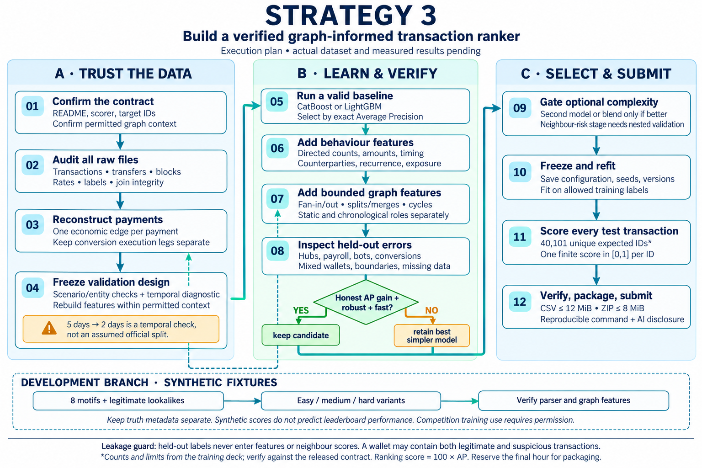
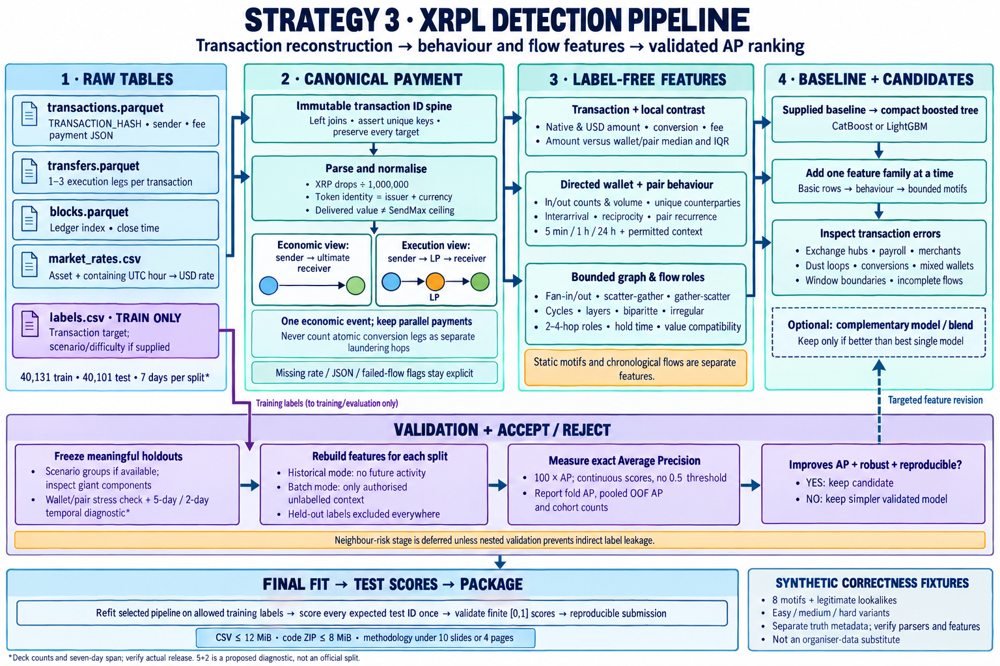

# Lumen.ai

Planning and research for the Decode & Detect XRP Ledger money-laundering detection challenge.

This repository contains the supplied training material, successive strategy documents, research notes, workflow diagrams, a data-generation prompt and a proposed final-model test plan. **It does not contain an organiser dataset, generated replica, trained detector or completed submission.**

## Start here

- [Strategy3: operational plan](Strategies/Strategy3.md)
- [Detailed HTML workflow](docs/strategy3-workflow.html) — download/open locally; works offline with navigation, explanations and review markers.
- [Research report](reports/XRPL%20strategy%20research.md)
- [Copy-ready dataset generation prompt](prompts/XRPL-dataset-replica-generation-prompt.md) — instructions for a future generator; no dataset has been generated.
- [Final-model edge-case review](reports/model-readiness/XRPL%20final%20model%20edge%20cases.md) and [44-check test ledger](reports/model-readiness/XRPL%20final%20model%20test%20ledger.csv) — proposed checks, initially **NOT RUN**.

## Workflow diagrams

### Detailed strategy flow

### XRPL-specific pipeline

The [simplified high-level diagram](docs/assets/strategy3-high-level.png) is also retained. All three diagrams are AI-generated explanatory assets; they describe planned work and are not evidence of executed experiments.

## Training material and earlier plans

- [Domain training transcript](MeetingTranscribe/Meeting1.txt)
- [Challenge briefing transcript](MeetingTranscribe/Meeting2.txt)
- [XRPL workshop transcript](MeetingTranscribe/Meeting3.txt)
- [Training PowerPoint](Pdf/Decode%20%26%20Detect%20AML%20Training%20-%20final.pptx) — 28 slides; the `Pdf` directory contains a PPTX, not a PDF.
- [Strategy1](Strategies/Strategy1.txt) and [Strategy2](Strategies/Strategy2.txt) — historical drafts containing assumptions later corrected in Strategy3 and the research report.

Transcripts contain transcription errors. Consult the deck and released organiser documentation for precise requirements. Training material retains its original authorship; this repository does not assign a new blanket licence to third-party material.

## Research trail

- [Local evidence and XRPL semantics audit](research_notes/XRPL%20strategy%20research/local_audit.md)
- [GitHub and AML graph research](research_notes/XRPL%20strategy%20research/github_aml.md)
- [Kaggle validation and competition research](research_notes/XRPL%20strategy%20research/kaggle_strategy.md)

Sources and access limitations are recorded in the research documents. Exact private-data similarity cannot be established without the organiser's schema and distributions. Any synthetic examples should remain clearly labelled development material; their competition use must follow the organiser's rules.
