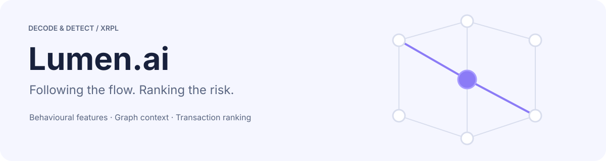
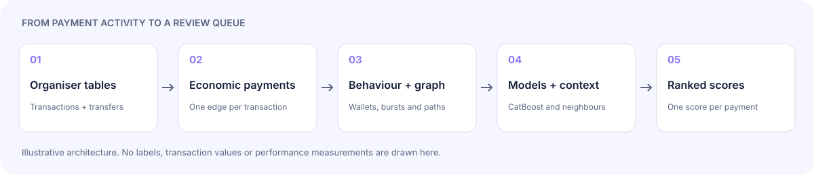

<div align="center">

<picture>
  <source media="(prefers-color-scheme: dark)" srcset="docs/assets/lumen-hero-dark.svg">
  
</picture>

<br>


[The problem](#the-problem) ·
[How it works](#how-it-works) ·
[Results](#results) ·
[Quick start](#quick-start) ·
[Reproduction](#reproducing-a-version) ·
[Layout](#repository-layout) ·
[Limits](#known-limits)

</div>

**Lumen.ai** ranks synthetic XRP Ledger payments by suspiciousness. It was built for the Decode & Detect challenge: a week of payment activity, a small number of planted laundering scenarios, and plenty of legitimate transactions that look similar.

The detector follows the behaviour around a payment: who receives and forwards funds, how quickly they move, whether several routes meet again, and whether that activity is unusual for the wallets involved. CatBoost combines those signals into one score per transaction.

This repository contains the working detector, versioned experiment source, error-analysis tools, strategy documents and research. Competition datasets, prediction exports and trained weights are kept out of Git. You need your own authorised copies of the organiser's data to run it.

## The problem

A fast transfer is not automatically suspicious. Payroll hubs, exchange-like services and treasury relays can resemble a planted laundering network. The useful question is whether the timing, counterparties and amounts form a coordinated pattern that is unusual for those wallets.

The released training split contains **40,131 transactions and 1,250 positives**. Its harder historical relays overlap heavily with legitimate activity. The organiser also includes **25 deliberately ambiguous labels independent of observable features**.

**The competition score is 100 × average precision (AP).** Precision and recall at the top 1% are separate diagnostics. High precision at that small cutoff does not imply high overall AP.

## How it works

<picture>
  <source media="(prefers-color-scheme: dark)" srcset="docs/assets/lumen-pipeline-dark.svg">
  
</picture>

1. **Reconstruct economic payments.** One transaction becomes one sender-to-recipient edge. Conversion legs remain part of that payment; liquidity-provider legs are not additional laundering hops. Issuer-aware market rates provide reference-USD values.
2. **Describe behaviour.** Wallet and pair statistics, directional flows, amount compatibility and graph roles form the original 457-feature baseline.
3. **Describe local patterns.** Multi-scale burst components, bounded ego networks, burst-versus-wallet activity and reconverging paths capture coordinated movement over minutes and hours.
4. **Fit the first stage.** CatBoost scores each payment from those observable features.
5. **Add neighbour context.** Grouped out-of-fold first-stage scores provide training context. At inference, a model fitted on the training window scores the separate test window, whose scores supply its own neighbour context.
6. **Rank transactions.** A second CatBoost model and percentile-rank blends combine the signals. The output is `TRANSACTION_HASH,score`, with scores in [0, 1]. No script submits automatically.

<details>
<summary><b>What the feature blocks measure</b></summary>

<br>

| Block | Question | Source |
|---|---|---|
| Payment semantics | What was actually paid and delivered? | [payments.py](solution/payments.py), [features.py](solution/features.py) |
| Wallet and pair history | Is this relationship recurring, concentrated or unusually active? | [features.py](solution/features.py) |
| Bursts and ego networks | Do nearby payments form a coordinated local structure? | [motif.py](solution/motif.py) |
| Burst context | Is this busy spell normal for this wallet? | [burst_context.py](solution/burst_context.py) |
| Slow scatter-gather | Do value-compatible two-hop paths share endpoints over hours? | [path_features.py](solution/path_features.py) |
| Model context | Are nearby payments suspicious under the first-stage model? | [context.py](solution/context.py) |

Burst components can extend beyond their nominal inter-payment gap through transitive links. Ego windows are anchored to the payment instead. Reference-USD path compatibility is a feature, not proof that the same funds travelled through a route.

</details>

## Results

These are **local grouped out-of-fold metrics**, not newly verified leaderboard results. Three fixed folds group cohort, otherwise scenario, otherwise background row. The development folds were reused across experiments.

| Evaluated recipe | Mean fold AP ×100 | Pooled OOF AP ×100 | Positives in top 402 |
|---|---:|---:|---:|
| Frozen V1 baseline | 54.48 | 53.72 | 326 |
| V4 motif + context blend | 61.62 | 61.53 | 355 |
| V13 half: V11 + V12 rank blend | 64.40 | 64.20 | 350 |
| V14 half: slow-path features + context | 64.21 | 64.05 | 351 |

**“Half” matters.** Those later OOF figures evaluate the fitting mode that excludes hard-tier positives. Packaged V13/V14 predictions additionally blend both fitting modes; the table does not establish those exact final packages' performance. V14's stage-one improvement did not translate into a better full half-pipeline than V13. Later V15–V17 and neural experiments are retained in the source archive; they are not certified winners by this table.

The original V1 top-402 review contained **76 false positives and 924 missed positives**. Historical relays and medium scenarios, rather than only isolated high-scoring examples, drove the subsequent work. See the [error-report builder](outputs/validation_error_report/build_report.py), [model research](reports/Lumen%20model%20improvement%20research.md) and [readiness review](reports/model-readiness/XRPL%20final%20model%20edge%20cases.md).

## Quick start

**You need Python 3.12 and the released competition data.** Development used Python 3.12.13 on an Apple Silicon Mac with 8 GB RAM. The core pipeline uses CPU CatBoost and does not require a GPU or API key.

```bash
git clone https://github.com/thisisshivamtiwari/lumen-ai.git
cd lumen-ai
python3.12 -m venv .venv
source .venv/bin/activate
python -m pip install -r solution/requirements.txt
```

Place your authorised data in this layout. Each data directory contains `transactions.parquet`, `transfers.parquet`, `blocks.parquet` and `market_rates.csv`; the training directory also contains `labels.csv`.

```text
data/
├── training/
│   ├── train/          labelled training window
│   └── validation/     unlabelled practice window
└── test/               scored test window
```

Run the original fixed V1 model:

```bash
python solution/run.py   --train data/training/train   --test data/test   --output outputs/local/predictions.csv
```

Run the current graph/context pipeline with the hard-tier positives retained in fitting:

```bash
python solution/run_v3.py --keep-hard   --train data/training/train   --test data/test   --output outputs/local/context_predictions.csv
```

Both commands write predictions and a report beside them. The first is the frozen baseline recipe; the second is the current experimental pipeline, not a claim to reproduce every previous submission. The data loader, features and inference run locally. Installation and cloning need network access.

## Reproducing a version

Source snapshots are retained under `outputs/` while generated data and binaries stay ignored. Choose a version's README and run its commands **from that package directory**, using absolute dataset paths:

- [V1 submission source](outputs/final_submission/lumen_strategy3_v1_code/README.md)
- [V13 blend source and commands](outputs/v13_final/lumen_v13_code/README.md)
- [V14 path-feature source and commands](outputs/v14_paths/lumen_v14_code/README.md)
- [V15 blend source and commands](outputs/v15_final/lumen_v15_code/README.md)
- [Source archive guide](outputs/README.md)

The root `solution/` directory is the development version. Archived copies preserve different feature sets and flags. Some research scripts expect generated feature caches and OOF files from the original local workspace; those are not included. The PyTorch stretch experiment requires a separate PyTorch installation and is explicitly unvalidated; it is not a core dependency.

<details>
<summary><b>Prediction and archive checks</b></summary>

<br>

Each prediction must have exactly one row per expected test hash and a finite score between 0 and 1. The supplied checker also checks ZIP size, required files and archive paths:

```bash
python solution/verify_submission.py   --test data/test   --predictions /path/to/predictions.csv   --code-zip /path/to/submission_code.zip   --report /path/to/artifact_validation.json
```

This checker expects a competition submission ZIP, including its methodology PDF. It is not a test for a GitHub source archive. Passing file checks establishes neither a hidden-test score nor acceptance by the organiser.

</details>

## Repository layout

```text
lumen-ai/
├── solution/           current feature builders, models and CLI commands
├── outputs/            versioned source, experiment scripts and selected metrics
├── Strategies/         three successive strategy plans
├── docs/               offline HTML workflow, diagrams and asset generator
├── reports/            research and proposed readiness checks
├── research_notes/     source-by-source research notes
├── prompts/            historical dataset-generation prompt
├── MeetingTranscribe/  original workshop transcripts
└── Pdf/                original workshop PowerPoint
```

The historical data-generation prompt was planning material. The detector uses the released competition data; no claim is made that a synthetic replica matches private test data.

## Known limits

- **Synthetic challenge, not production AML.** A score is a ranking signal, not a finding that a person or payment is criminal.
- **Hard cases remain weak.** Ambiguous independent labels have no recoverable feature-based answer. There is no guaranteed 75 or 80 score.
- **Validation is not fully wallet-disjoint.** Grouped folds share wallets, repeated selection can inflate gains, and later candidates do not all have wallet and temporal confirmation.
- **Offline window context.** Features can use other unlabelled payments from the authorised same window, including later payments. This is not a causal streaming detector.
- **Stacking needs care.** Outer-fold protection does not remove every training-side own-label dependency in neighbour-score construction. The [stacking audit](research_notes/Lumen%20model%20improvement%20research/stacking_audit.md) explains the distinction.
- **Annotations are not inference features.** The baseline uses annotations for grouping/evaluation. Later variants also use difficulty for fitting-row selection; the optional `--aux` experiment uses family as a training target and is off by default. These choices are disclosed rather than described as annotation-free training.
- **No blanket promotion of experiments.** Rejected features and unvalidated neural/stretch runs are retained for inspection. Their presence does not mean they improved the final detector.

## Research and provenance

Start with [Strategy3](Strategies/Strategy3.md), the [offline workflow](docs/strategy3-workflow.html), the [XRPL research report](reports/XRPL%20strategy%20research.md), and the [later improvement research](reports/Lumen%20model%20improvement%20research.md). Earlier diagrams describe the planned strategy and are not experiment evidence. The README's SVGs are explanatory illustrations generated by [docs/generate_readme_assets.py](docs/generate_readme_assets.py).

Original solution code is covered by the scoped [MIT licence](solution/LICENSE). Organiser helpers, extracted starter features, transcripts and slides retain their own authorship and applicable terms. See [third-party attribution](solution/THIRD_PARTY.md) and [AI disclosure](solution/AI_DISCLOSURE.md). Archived package disclosures record additional assistance during development.

<div align="center">
<br>
<sub>Built by <a href="https://github.com/thisisshivamtiwari">Shivam Tiwari</a> for Decode & Detect.</sub>
</div>
